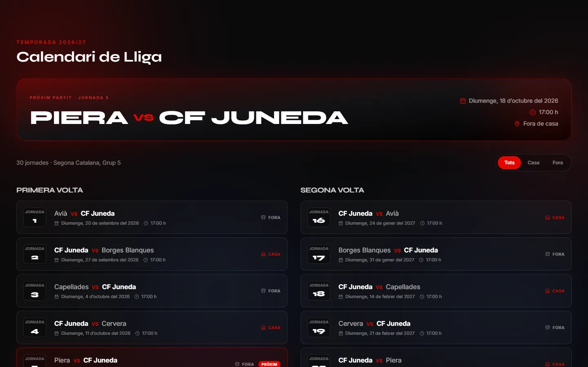
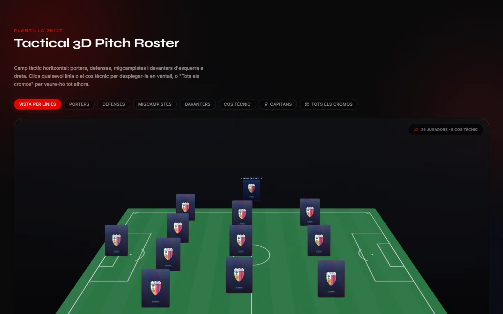
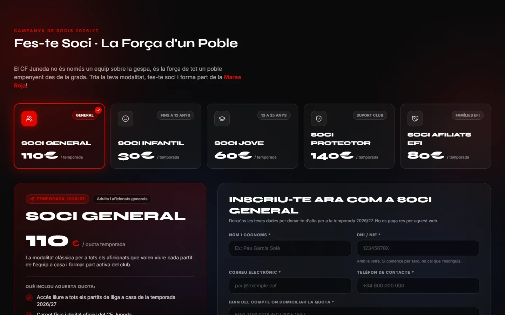
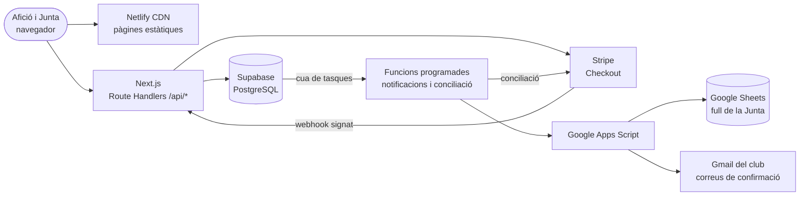
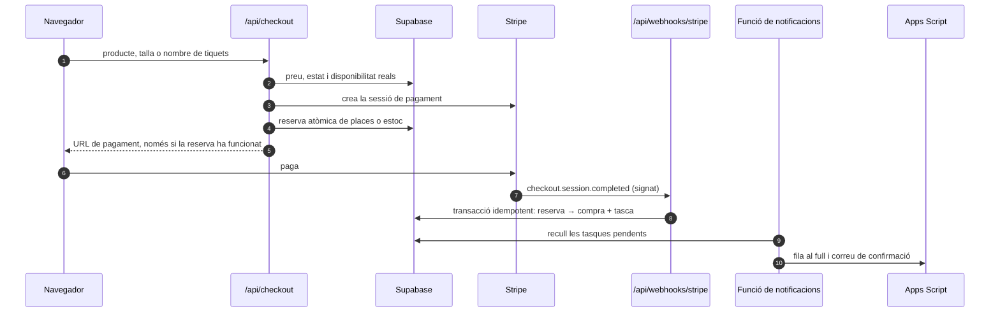

<div align="center">


# Web oficial del CF Juneda

**Calendari, plantilla en 3D, socis, botiga i reserves del Club Futbol Juneda, amb panell de gestió per a la Junta.**

[](https://cf-juneda.netlify.app)

[](https://github.com/Barru23/FC_JUNEDA_Web_Page/actions/workflows/checks.yml)


</div>

> **English summary** — Production website for CF Juneda, an amateur football club in Catalonia. Fans can follow the 2026/27 league calendar, explore the squad on an interactive 3D pitch, sign up as members (SEPA direct debit) and buy event tickets and merchandise through Stripe Checkout. The club board manages events, products, cash sales, members and finances from a protected admin panel, with every record mirrored to a Google Sheet and confirmation emails sent from the club's own account. Built with Next.js 15, React 19, TypeScript, Three.js, Supabase and Stripe, deployed on Netlify.

<p align="center">
  
</p>

<table>
  <tr>
    <td width="33%"></td>
    <td width="33%"></td>
    <td width="33%"></td>
  </tr>
  <tr>
    <td align="center"><sub>Calendari de 30 jornades</sub></td>
    <td align="center"><sub>Plantilla en un camp 3D</sub></td>
    <td align="center"><sub>Alta de socis amb mandat SEPA</sub></td>
  </tr>
</table>

<p align="center">
  <br />
  <sub>Pensada primer per al mòbil</sub>
</p>

## Què fa

La web reuneix en un sol lloc la informació esportiva i els serveis digitals del club per a la temporada 2026/27, en què el primer equip competeix a **Segona Catalana, Grup 5**. L'afició pot seguir l'equip i fer gestions des del mòbil, mentre la Junta rep les dades i controla les operacions des d'un panell propi.

### Web pública

- Calendari complet de les 30 jornades de lliga, amb pròxim partit i filtres de casa/fora.
- Plantilla i cos tècnic presentats com a cromos sobre un camp tàctic 3D interactiu.
- Alta de socis amb modalitats, validació de DNI/NIE i IBAN i mandat de domiciliació.
- Botiga oficial amb talla, estoc i personalització de dorsal.
- Reserva i pagament de dinars, sopars i altres esdeveniments del club.
- Pàgina de confirmació de compra que consulta l'estat real del pagament a Stripe.
- Avís legal, política de privacitat i condicions de compra.
- Disseny responsive, animacions respectuoses amb `prefers-reduced-motion` i navegació accessible per seccions.

### Panell d'administració

La ruta `/admin` permet a la Junta:

- Consultar ingressos, tiquets, comandes, despeses de gestió i altes de socis.
- Crear, editar i cancel·lar esdeveniments, amb pujada d'imatges.
- Crear, editar i ocultar productes de la botiga.
- Registrar cobraments manuals en efectiu.
- Marcar altes com a domiciliades o anul·lades; els pagaments es concilien amb Stripe.
- Exportar dades en CSV i obrir el full mestre de Google Sheets.

El calendari esportiu no es gestiona des del panell: és contingut oficial versionat a `content/matches.json`, de manera que cada canvi queda auditable a Git.

## Stack tecnològic

| Capa | Tecnologia |
|---|---|
| Interfície | **Next.js 15** (App Router), **React 19**, **TypeScript**, **Tailwind CSS 3**, **Framer Motion**, Lucide React, `next/font` (Syne i Inter) |
| 3D | **Three.js**, **React Three Fiber**, Drei i Postprocessing, carregats sota demanda quan la secció s'acosta a la pantalla |
| Backend | **Route Handlers de Next.js**. El navegador no accedeix mai directament a Supabase ni rep la clau de servei |
| Dades | **Supabase / PostgreSQL**, amb funcions transaccionals en PL/pgSQL i RLS |
| Pagaments | **Stripe Checkout** i webhooks signats, amb suport per a mètodes immediats i asíncrons |
| Integracions | **Google Apps Script** com a pont cap a Google Sheets i Gmail |
| Desplegament | **Netlify**, amb funcions programades per a la conciliació i les notificacions |
| Qualitat | Tests amb `node:test` i PostgreSQL en memòria (PGlite), i GitHub Actions |

## Arquitectura



### Compra d'un producte o reserva d'un esdeveniment



1. La interfície carrega el catàleg actiu des de `/api/products` o `/api/events`.
2. `/api/checkout` valida les dades i torna a consultar a Supabase el preu, l'estat i la disponibilitat. No accepta com a fiable cap preu enviat pel navegador.
3. El servidor crea una sessió de Stripe d'uns 30 minuts i reserva places o estoc amb una operació atòmica. La URL de pagament només es retorna si la reserva ha funcionat.
4. Stripe crida `/api/webhooks/stripe` i la signatura es verifica abans d'actualitzar res. `checkout.session.completed` confirma els mètodes immediats i `checkout.session.async_payment_succeeded`, els asíncrons.
5. Una transacció idempotent converteix la reserva en una compra. Webhooks repetits i la pàgina `/success` poden coincidir sense duplicar files ni descomptar dues vegades.
6. Si la sessió caduca o el pagament asíncron falla, l'estoc reservat es recupera exactament una vegada.
7. La mateixa transacció crea una tasca de sincronització. Una funció de Netlify l'envia a Apps Script amb un identificador estable, reintents i control de duplicats. Si Google falla, la compra continua registrada i el panell mostra la incidència.

La pantalla `/success` consulta Stripe al servidor i només mostra **Pagament confirmat** quan `payment_status` és `paid`. La resposta pública conté només el resum necessari i el correu emmascarat.

### Alta de soci

L'alta no cobra en línia. `/api/socis` valida les dades, desa el registre a `soci_registrations` i l'envia al full de la Junta. El DNI i l'IBAN només circulen pel servidor i per les eines internes necessàries per preparar la domiciliació. La Junta activa l'alta quan el cobrament queda gestionat.

### Fonts de dades

- `content/matches.json`: calendari oficial del primer equip.
- `content/memberships.json`: presentació i modalitats base de socis.
- `content/events.json`: llavor per a esdeveniments antics; després Supabase és la font viva.
- Supabase: esdeveniments publicats, productes, inventari, compres i altes.
- `lib/squad.ts`: plantilla i estructura esportiva.

## Seguretat i fiabilitat

- **Preus i estoc decidits al servidor.** El navegador només indica què vol comprar.
- **Webhooks de Stripe verificats per signatura** i processats de manera idempotent.
- **Reserves d'inventari atòmiques** amb funcions PL/pgSQL, i una conciliació periòdica que allibera les sessions caducades.
- **Sessions d'administració opaques**: token aleatori de 256 bits desat com a hash, cookie `httpOnly` i `SameSite=Strict`, caducitat i revocació. La contrasenya es compara en temps constant.
- **Límit de peticions persistent** a PostgreSQL, basat en l'adreça que dona la plataforma i no en capçaleres que pugui falsificar el client.
- **Permisos mínims a la base de dades**: RLS activat i funcions transaccionals reservades a la clau de servei.
- **Protecció contra injecció de fórmules** al full de càlcul i a les exportacions CSV, i HTML escapat als correus.
- **Capçaleres de seguretat**: CSP, protecció contra `iframe`, MIME sniffing i polítiques de referència i permisos restrictives.
- **Tests de regressió** de pagaments, inventari, límits i sessions amb PostgreSQL en memòria, executats a cada push.

## Estructura principal

```text
app/                 Pàgines, panell d'administració i rutes API
components/          Seccions públiques, modals, botiga i components 3D
content/             Catàlegs versionats, inclòs el calendari
lib/                 Domini, validació i integracions de servidor
netlify/functions/   Funcions programades de notificacions i conciliació
public/              Imatges optimitzades i recursos que sí pot servir el web
apps-script/Codi.gs  Integració amb Google Sheets i correus
supabase-schema.sql  Esquema inicial de la base de dades
supabase/migrations/ Migracions posteriors
tests/               Proves automatitzades
docs/screenshots/    Captures d'aquest README
```

Les carpetes `assets/` (originals d'imatge) i `documents/` (fonts internes) són locals i estan ignorades per Git.

## Posada en marxa local

### Requisits

- Node.js 22 o superior.
- Un projecte de Supabase.
- Un compte de Stripe si es vol provar el checkout.
- Un full de Google Sheets amb l'Apps Script desplegat si es volen provar registres i correus.

### Instal·lació

```bash
git clone https://github.com/Barru23/FC_JUNEDA_Web_Page.git
cd FC_JUNEDA_Web_Page
npm install
cp .env.example .env.local
npm run dev
```

La web estarà disponible a `http://localhost:3000`.

### Base de dades

Executa `supabase-schema.sql` a l'editor SQL del projecte de Supabase. L'esquema crea les taules següents:

- `events`
- `products`
- `membership_tiers`
- `purchases`
- `checkout_reservations`
- `soci_registrations`

També inclou les funcions transaccionals de reserva, confirmació i alliberament d'inventari i les polítiques de lectura pública previstes. L'aplicació, però, accedeix a les dades mitjançant les rutes del servidor i la clau de servei.

Després d'una actualització de `supabase-schema.sql`, executa'l **abans de desplegar el codi que utilitza les funcions noves**. L'script es pot tornar a executar (`IF NOT EXISTS`, `CREATE OR REPLACE` i llavors amb conflicte controlat).

Aplica també les migracions de `supabase/migrations/` en ordre. La posada en marxa de la conciliació, les sessions i la cua de notificacions es descriu a [docs/PRODUCCIO.md](docs/PRODUCCIO.md).

### Google Apps Script

1. Obre el full mestre de la Junta i entra a **Extensions → Apps Script**.
2. Copia-hi `apps-script/Codi.gs`.
3. A **Configuració del projecte → Propietats de l'script**, crea la propietat `TOKEN` amb un secret llarg i exclusiu. El secret no s'escriu mai a `Codi.gs`.
4. Desplega l'script com a aplicació web, executada pel propietari i accessible per a qualsevol persona.
5. Desa la URL `/exec` a `APPS_SCRIPT_URL` i el mateix secret a `APPS_SCRIPT_TOKEN`.
6. Després de cada canvi a l'script, publica una versió nova del desplegament.

El token d'Apps Script ha de ser diferent de la contrasenya d'administració.
El contacte canònic dels textos legals, el peu i els correus és `junedaclubfutbol@gmail.com`. Si es modifica `apps-script/Codi.gs`, cal crear una versió nova del desplegament perquè el canvi arribi als correus reals.

## Variables d'entorn

| Variable | Ús |
|---|---|
| `STRIPE_SECRET_KEY` | Crear i consultar sessions de Stripe al servidor. |
| `STRIPE_WEBHOOK_SECRET` | Verificar la signatura dels webhooks. |
| `NEXT_PUBLIC_SUPABASE_URL` | URL del projecte de Supabase. |
| `SUPABASE_SERVICE_ROLE_KEY` | Accés de servidor a la base de dades; mai no s'ha d'exposar al navegador. |
| `APPS_SCRIPT_URL` | URL `/exec` del pont de Sheets i correus. |
| `APPS_SCRIPT_TOKEN` | Secret compartit amb la propietat `TOKEN` de l'Apps Script. |
| `NEXT_PUBLIC_MASTER_SHEET_ID` | Activa l'enllaç al full mestre dins l'administració. |
| `ADMIN_PASSWORD` | Protegeix les rutes administratives. |
| `NEXT_PUBLIC_SITE_URL` | URL pública usada pel retorn de Stripe; a Netlify pot derivar-se de `URL`, però es declara explícitament. |

Copia `.env.example` a `.env.local`, substitueix tots els valors de mostra i no versionis mai `.env.local` ni cap clau real.

## Ordres útils

```bash
npm run dev                # servidor de desenvolupament
npm test                   # proves automatitzades
npm run build              # build de producció
npm run start              # executar el build
npm run validate:calendar  # validar les 30 jornades i els enfrontaments
npm run typecheck          # comprovació de tipus
```

## Manteniment del calendari

Cada registre de `content/matches.json` conté:

```json
{
  "round": 1,
  "date": "2026-09-20",
  "time": "17:00",
  "opponent": "Avià",
  "venue": "away"
}
```

- `date` sempre ha d'estar en format ISO `YYYY-MM-DD`.
- `venue` només pot ser `home` o `away`.
- Les jornades han d'estar ordenades i no es poden repetir.
- Els canvis de la Federació s'han d'aplicar al fitxer i publicar amb un desplegament nou.
- El PDF original de la Federació es conserva només en local, perquè conté dades de contacte dels clubs.

## Qualitat i desplegament

Cada push executa a GitHub Actions les proves, la validació del calendari i el build. Netlify torna a passar les proves abans de cada desplegament. En local:

```bash
npm test
npm run validate:calendar
npm run build
```

Configura a Netlify les mateixes variables d'entorn, registra el webhook de producció de Stripe apuntant al domini de Netlify i confirma que Apps Script respon a la seva URL `/exec`. El projecte de Netlify ha de tenir la visibilitat pública: els projectes nous són privats per defecte i el webhook rebria un 401. Els canvis de variables només arriben a les funcions amb un desplegament nou.

El webhook de Stripe ha d'escoltar aquests quatre esdeveniments:

- `checkout.session.completed`
- `checkout.session.async_payment_succeeded`
- `checkout.session.async_payment_failed`
- `checkout.session.expired`

### Monitoratge

Un monitor extern consulta periòdicament una ruta que llegeix de la base de dades. Així avisa tant si cau la web com si cau Supabase, i l'activitat regular evita que el pla gratuït de Supabase pausi el projecte en les setmanes sense visites.

Quan salti l'alerta, comprova-ho en aquest ordre: si el projecte de Supabase està pausat (el cas més probable, que es resol amb **Restore project** al seu panell), si un desplegament recent ha trencat res, i l'estat de Netlify.

### Revisió anual de conservació de dades

No hi ha cap esborrat automàtic, per evitar una eliminació irreversible per error. Un cop l'any, una persona de la Junta ha de:

1. Exportar una còpia protegida de les dades que calgui conservar i comprovar que es pot obrir.
2. Revisar `soci_registrations`, `purchases` i les pestanyes de Google Sheets d'acord amb el termini publicat a la política de privacitat i les obligacions comptables aplicables.
3. Eliminar les dades personals que ja no siguin necessàries tant de Supabase com dels fulls i de les còpies operatives; davant del dubte legal, no eliminar-les fins que el club ho hagi confirmat.
4. Registrar la data, la persona responsable, els conjunts revisats i el resultat, sense copiar DNI, IBAN ni altres dades personals al registre de manteniment.
5. Verificar des del panell que la temporada actual, els totals i les altes actives continuen correctes.

### Altres detalls de qualitat

- `robots.txt`, `sitemap.xml`, icona, canonical, Open Graph, Twitter Cards i dades estructurades del club.
- Modals amb focus inicial, bucle de teclat, tancament amb `Esc` i retorn del focus.
- Imatges optimitzades a WebP, originals pesants fora de `public/` i càrrega diferida del camp 3D.
- El loader inicial amb l'escut forma part del disseny del club i es manté deliberadament.

## Autoria i llicència

Disseny i desenvolupament: **Gerard Barrufet Segarra** ([@Barru23](https://github.com/Barru23)).

El codi es publica amb finalitats de portafoli, amb tots els drets reservats: vegeu [`LICENSE`](./LICENSE). El nom, l'escut, les equipacions i les imatges del Club Futbol Juneda i dels seus jugadors són propietat del club.

---

<p align="center"><b>Som-hi Rojos! Això és Juneda.</b></p>
